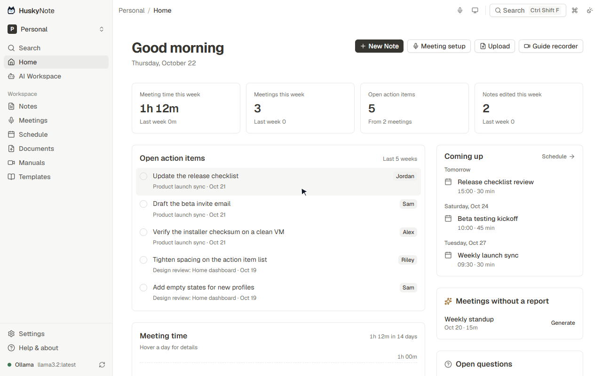

<div align="center">

# 🐺 HuskyNote

### Your Local AI Secretary

**Local-first AI note-taking, meetings, documents, and SOP capture.**
Capture it. Understand it. Keep it.

[](LICENSE)
[](https://www.typescriptlang.org/)
[](https://react.dev/)
[](https://vitejs.dev/)

[Download](https://github.com/ChristianJayCuevas/HuskyNote/releases/latest) · [Features](#features) · [Run from source](#install--run-from-source) · [Roadmap](ROADMAP.md) · [Contributing](CONTRIBUTING.md)

<!-- Demo GIF: record per demo-gif-plan.md and save to docs/demo.gif -->


</div>

---

## Why local-first?

Meetings, notes, and internal documents are some of the most sensitive data you have. HuskyNote keeps them on **your** device:

- **Your data stays on your device.** Notes, meetings, audio, transcripts, and documents live in the app's local database (IndexedDB via Dexie), per profile.
- **No accounts, no cloud sync, no analytics, no trackers.** The update check is **off by default**; when enabled it only asks GitHub whether a newer release exists.
- **Transcription always runs on-device** (WebGPU or WASM), whichever AI provider you pick.
- **You choose where AI text goes** — fully local with Ollama, or opt into Claude / ChatGPT (Codex) with your own key or plan. API keys are left out of backups.

## Features

### 🎙️ Meetings
- Record your **microphone, a browser tab's audio, or both**.
- **On-device transcription** with selectable engines: **Parakeet** (default, GPU when available), **Moonshine** (lightweight, English), **Whisper** (multilingual, incl. Filipino/Taglish), plus experimental Whisper Small/Turbo and a local engine benchmark.
- **Crash-resilient recording** — audio is saved every second; **Finish saving** rebuilds interrupted recordings.
- **AI meeting reports**: summary, key decisions, tickable action items, topics, follow-ups, and a timeline. Generate later if no AI was connected.
- **Import** Microsoft Teams transcripts (`.vtt` / `.docx` / pasted text) or audio/video files (transcribed locally).
- **Supplement** a recording with its Teams transcript (time-aligned, speaker names, optional AI cleanup, **Restore original**).
- **Merge / Unmerge** recordings that belong to one meeting.
- **Export** a designed PDF report or an AI-ready Markdown file (details, report, notes, full timestamped transcript).

### 📝 Notes
- Markdown editor with autosave and a visible save state (unsaved / saving / saved / failed + Retry).
- Version history with restore, tags, templates, and undo-after-delete.

### 📄 Documents
- PDF reader (PDF.js) with thumbnails, highlights, shapes, numbered step badges, and page-anchored notes.
- Select text to **Explain, Summarize, Simplify, Make Notes, or Ask AI**.
- **Turn into Steps** converts a section into a numbered procedure citing its pages.

### 🧭 Step guides (SOP capture)
- Capture screens during a task and build a step-by-step guide.
- Reorder steps; add warnings, prerequisites, expected results, and troubleshooting.
- Export to **PDF, Markdown, or JSON**.

### 🤖 AI Workspace & Home
- Attach notes, meetings, and documents as context; chat or run **Summarize, Extract Tasks, Create SOP, Find Decisions, Find Risks**; save answers as notes.
- Home dashboard: open action items, meeting time, upcoming schedule, meetings without reports, recent work.
- Full-text search across everything plus a command palette.

### 🗂️ Profiles & backups
- Separate **profiles** per job/project, each with its own notes, meetings, documents, guides, and schedule.
- Complete **`.huskybackup`** archives (including audio) from **Settings → Storage**, restorable into a new profile. See [BACKUP_FORMAT.md](BACKUP_FORMAT.md).

### 🧩 Extras
- **Browser extension** (Chrome/Edge, [`browser-extension/`](browser-extension)): collect Teams transcripts, capture Google Meet audio, right-click save/summarize.
- **Optional Python companion** ([`local-companion/`](local-companion)): desktop screen capture and Faster-Whisper.
- **Desktop apps** for Windows (WebView2), macOS (WKWebView), and Linux (AppImage/tarball).
- UI localized in English, French, Japanese, and Chinese.

## Tech stack

| Layer | Tools |
| --- | --- |
| App | React 18, TypeScript, Vite 6 |
| UI | Tailwind CSS, Radix UI / shadcn/ui, lucide-react, cmdk |
| Storage | IndexedDB via Dexie |
| Speech | `parakeet.js`, `@huggingface/transformers` (Moonshine / Whisper), WebGPU or WASM |
| Documents & export | pdfjs-dist, jsPDF, react-markdown + remark-gfm, DOMPurify |
| AI | Ollama (local), `@anthropic-ai/sdk`, Claude Code CLI bridge, Codex CLI bridge (`server/`) |
| Desktop shells | .NET / WebView2 (Windows), Swift / WKWebView (macOS), AppImage (Linux) |
| Testing | Vitest, Testing Library, fake-indexeddb, Playwright browser checks |

## Install & run from source

**Prefer a prebuilt app?** Grab it from [Releases](https://github.com/ChristianJayCuevas/HuskyNote/releases/latest) (v0.7.0 ships Windows builds; the latest macOS and Linux builds are in v0.6.0).

Requires **Node.js 20 or 22**.

```bash
git clone https://github.com/ChristianJayCuevas/HuskyNote.git
cd HuskyNote
npm install
npm run dev          # http://127.0.0.1:5173
```

Quick-start scripts (check for Ollama, install dependencies, launch):

| System | Command |
| --- | --- |
| macOS / Linux | `./start.sh` |
| Windows | `scripts\setup-windows.bat` (or `npm run setup:windows`) |
| Any | `npm start` |
| Install/configure Ollama only | `npm run setup:ollama` |

Main `package.json` scripts:

```bash
npm run dev                         # Vite dev server
npm run build                       # tsc -b && vite build
npm run preview                     # preview the production build
npm test                            # Vitest unit/integration tests
npm run test:ui-browser             # browser UI regression checks
npm run test:transcription-browser  # browser transcription checks
npm run test:backup-browser         # browser backup/restore checks
npm run build:windows               # Windows app + installer (.NET 9 SDK)
npm run setup:ollama                # install/configure Ollama
npm start                           # quick-start launcher
```

## Configuration

### AI providers (Settings → AI)

| Provider | What you need | Where your text goes |
| --- | --- | --- |
| **Local AI (Ollama)** | [Ollama](https://ollama.com) with a model such as Llama 3.2, Gemma, or Qwen | Stays on this computer (`http://localhost:11434`) |
| **Claude** | Your Anthropic API key | Anthropic |
| **Claude Subscription** | Claude Code installed & signed in (Windows app or `npm run dev`) | Anthropic, via local Claude Code |
| **ChatGPT (Codex)** | Codex app/CLI installed & signed in (Windows app or `npm run dev`) | OpenAI, via local Codex |

The Claude Code and Codex bridges run the official CLIs with tools disabled; HuskyNote never handles your sign-in credentials.

### Environment (`.env`)

Optionally copy `.env.example` to `.env`. Only non-secret `VITE_`-prefixed values belong here, because they are bundled into the client.

```env
VITE_OLLAMA_BASE_URL=http://localhost:11434
VITE_DEFAULT_MODEL=llama3.2:latest
VITE_LOCAL_COMPANION_URL=http://localhost:8765
```

Ollama URL and model can also be changed in-app. Transcription engine is chosen in **Settings → Transcription**.

### Optional local companion

```bash
cd local-companion
python3 -m venv venv && source venv/bin/activate
pip install -r requirements.txt
python main.py      # serves http://127.0.0.1:8765
```

## Roadmap (planned)

> These items are **planned, not shipped**. Full details and acceptance criteria in [ROADMAP.md](ROADMAP.md).

- **M1 – Protect user work:** storage usage/quota visibility; verified legacy migration and profile isolation *(backup archive format already implemented)*.
- **M2 – Trust everyday capture:** first-run readiness flow, clearer model downloads, recording-failure hardening, browser-driven end-to-end tests, capability matrix.
- **M3 – Connect knowledge to action:** ranked/filtered search with jump-to-source, traceable AI source references, action items → schedule.
- **M4 – Dependable release:** verified install/upgrade/uninstall on all platforms, security review of bridges and companion, accessibility pass.
- **Later (evidence-driven):** local OCR, local semantic retrieval, more calendar integrations, optional encrypted sync.

## Contributing

Contributions are welcome! Please read [CONTRIBUTING.md](CONTRIBUTING.md) and use the issue templates for bugs and feature requests. Before opening a PR:

```bash
npm test && npm run build
```

CI runs the tests (Node 20 and 22) and the Windows, macOS, and Linux desktop builds on every pull request to `main`. Report security issues per [SECURITY.md](SECURITY.md).

## License

[MIT](LICENSE). HuskyNote is a rebranded fork of [DomoNote](https://github.com/darknecrocities/DomoNote) by darknecrocities, used under the MIT License; the original copyright notice is retained in [LICENSE](LICENSE).
